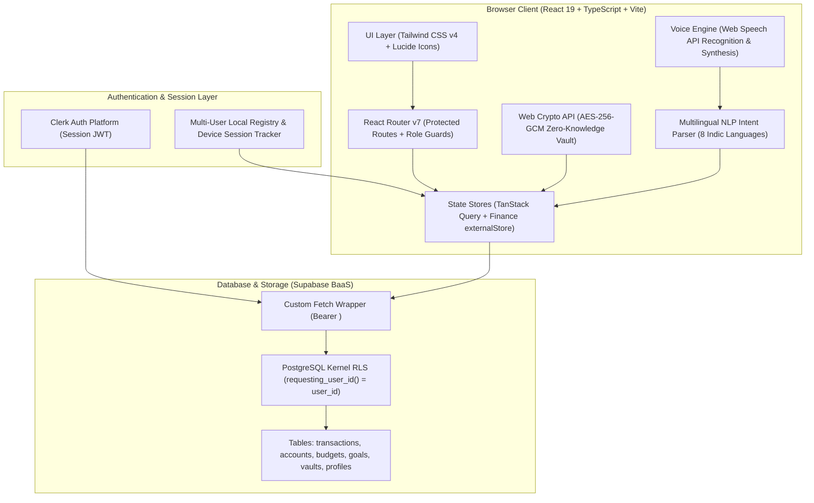

# FinSight AI — Intelligent Personal Finance, Budget Tracking & Multilingual Voice Copilot

> **"FinSight AI is a bank-grade personal finance intelligence platform combining real-time cash-flow tracking, multilingual voice copilot (8 Indic languages), zero-knowledge encrypted document vault, and PostgreSQL Row-Level Security (RLS)."**

[]()
[]()
[]()
[]()
[]()
[]()
[]()
[]()

---

## 🌐 Quick Links & Demo

- **GitHub Repository**: [https://github.com/tarun-789/Budget-Tracking-](https://github.com/tarun-789/Budget-Tracking-)
- **Local Dev Server**: `http://localhost:5173/`
- **Default Test Account**: `malipedditarun789@gmail.com` / `password123` *(or register any account / 1-click Quick Demo)*
- **Multi-Tenant Architecture**: Complete client-side & database isolation across independent user accounts.

---

## 🚀 Key Highlights & Flagship Features

### 1. 📊 Real-Time Financial Dashboard & Cash-Flow Engine
- **Live Net Calculations**: Dynamically computes Total Income, Expenses, Net Savings, and Savings Rate % on every ledger change.
- **Visual Analytics**: Interactive category breakdown charts, monthly burn rate trends, and account balance distributions.
- **Budget Health Gauges**: Real-time `Healthy`, `Warning` (threshold-based), and `Exceeded` status indicators.

### 2. 💳 Smart Transaction Management & Deduplication
- **Complete Transaction Ledger**: Add, edit, delete, tag, filter by category, payment method (UPI, Net Banking, Credit Card, Cash), and paginate.
- **Natural Date Queries**: Instant search by plain dates (e.g., *"12 Sep"*, *"2026-09-12"*, *"Today"*, *"Yesterday"*).
- **Intelligent Deduplication**: Multi-factor similarity scoring (Amount + Date + Narration + Account) detects duplicate copies and removes **redundant duplicates only**, preserving the original records.

### 3. 🌐 Multilingual Voice & Typing Financial Engine (8 Indic Languages)
- **Unified Processing Pipeline**: Text and speech share the same underlying financial processing engine.
- **8 Supported Languages**:
  | Language | Code | Typing | Voice |
  |---|---|:---:|:---:|
  | **English** | `en-IN` | ✅ | ✅ |
  | **Telugu (తెలుగు)** | `te-IN` | ✅ | ✅ |
  | **Hindi (हिन्दी)** | `hi-IN` | ✅ | ✅ |
  | **Tamil (தமிழ்)** | `ta-IN` | ✅ | ✅ |
  | **Kannada (ಕನ್ನಡ)** | `kn-IN` | ✅ | ✅ |
  | **Malayalam (മലയാളം)** | `ml-IN` | ✅ | ✅ |
  | **Bengali (বাংলা)** | `bn-IN` | ✅ | ✅ |
  | **Marathi (मराठी)** | `mr-IN` | ✅ | ✅ |
- **Financial Intent Extraction**:
  - User types / speaks in Telugu: `ఈరోజు ఫుడ్ కోసం 350 రూపాయలు ఖర్చు చేశాను`
  - System extracts structured JSON:
    ```json
    {
      "type": "expense",
      "amount": 350,
      "category": "Food",
      "date": "today"
    }
    ```
- **Voice Response**: Reads financial balance and transaction confirmations in the user's selected Indian language using Web Speech Synthesis.

### 4. 🔒 Zero-Knowledge Encrypted Document Vault
- **Client-Side AES-256-GCM Encryption**: Documents are encrypted directly in the user's browser before persistence. Only the user holds the encryption key.
- **Client-Side OCR Full-Text Extraction**: Automatically extracts text and identifies official document identifiers (Aadhaar, PAN, Driving License, Policy, Certificate numbers).
- **Privacy & Protection**: 4-digit PIN lock for sensitive files, document bundling (Job Dossier, Travel Packet), and version history.

### 5. 🔐 Enterprise Authentication, Clerk + Supabase RLS & Security
- **PostgreSQL Row Level Security (RLS)**: Enforces kernel-level data isolation via `requesting_user_id() = user_id`.
- **Clerk Auth Integration**: Custom `global.fetch` middleware that injects Clerk JWT session tokens (`template: 'supabase'`) into Supabase database requests.
- **Interactive Admin RLS Command Center**: Live JWT minting, token claims inspector (`sub`, `aud`), and real-time SQL query sandbox with latency metrics.
- **Strict RFC 5322 Email Validation**: Detects incomplete top-level domains (e.g. `@gmail.c`), blocks single-letter TLDs, and provides 1-click typo auto-correction to `@gmail.com`.
- **Real-Time Password Reset Flow**: Expiring single-use reset tokens (`rst_...`), dynamic 4-stage strength meter (Weak $\rightarrow$ Strong), checklist, and confirm password validation.
- **Device Session Management & Remote Sign-Out**:
  - Automatically captures browser, OS, and device type (Mobile vs Desktop).
  - Displays device details **only to that authenticated user**.
  - 1-Click remote sign-out revokes sessions from any unrecognized device.
  - Interactive simulation button to test other device logins (iPhone, MacBook, Android).

### 6. 🧠 AI Insights & What-If Budget Simulator
- **Statistical Anomaly Detection**: Z-Score deviation analysis ($Z > 1.5$) flags abnormal category spending spikes against rolling baselines.
- **Month-End Forecast**: Daily burn-rate calculations forecast projected month-end balance.
- **What-If Budget Simulator**: Adjust discretionary spending sliders (Dining, Entertainment, Shopping) to preview immediate monthly and annual savings impacts.

---

## 🏗️ System Architecture



---

## 🗄️ Database & Security Design

### PostgreSQL Tables (with RLS)
- `profiles` — User profile, preferred currency (`INR`), timezone, and admin flags.
- `accounts` — Bank accounts, credit cards, UPI wallets, investments, and credit limits.
- `transactions` — Financial entries with category tagging, payment methods, and AI confidence scores.
- `budgets` & `budget_categories` — Monthly budget allocations and category thresholds.
- `goals` — Savings milestones, target dates, and progress calculations.
- `notifications` — Budget warnings, anomaly alerts, and security notifications.

### PostgreSQL Row Level Security (RLS) Policy Example
```sql
-- Function to extract user ID from incoming JWT
CREATE OR REPLACE FUNCTION requesting_user_id()
RETURNS text AS $$
  SELECT NULLIF(
    current_setting('request.jwt.claims', true)::json->>'sub',
    ''
  )::text;
$$ LANGUAGE sql STABLE;

-- Enforce strict RLS on transactions
ALTER TABLE public.transactions ENABLE ROW LEVEL SECURITY;

CREATE POLICY "Users can only read and manage their own transactions"
ON public.transactions FOR ALL
USING (requesting_user_id() = user_id)
WITH CHECK (requesting_user_id() = user_id);
```

---

## 📁 Repository Directory Structure

```
finsight-ai/
├── public/                 # Static assets, web manifests, brand SVGs
├── src/
│   ├── components/         # Reusable UI components
│   │   ├── auth/           # ClerkSupabaseProvider (dual-mode live/fallback)
│   │   ├── common/         # CommandPaletteModal (Ctrl+K), LanguageSelector, Notifications
│   │   ├── documents/      # CameraScanner, Annotation, Bundle, PinLock, ZeroKnowledge
│   │   ├── guards/         # ProtectedRoute, AdminOnly, RequireRole
│   │   ├── ui/             # StatCard, EmptyState, ErrorState, LoadingSpinner
│   │   └── voice/          # VoiceAssistantModal (multilingual voice recognition)
│   ├── contexts/           # AuthContext, VoiceAssistantContext
│   ├── hooks/              # useClerkSupabaseClient, useDebounce, useFinanceStore
│   ├── layouts/            # AppLayout (Sidebar, Breadcrumbs, Notifications), AuthLayout
│   ├── lib/                # clerkSupabase, supabase client, queryClient
│   ├── pages/              # 13 Application Views
│   │   ├── Dashboard.tsx       # Live cash-flow analytics and account summaries
│   │   ├── Transactions.tsx    # Transaction ledger, date search & deduplication
│   │   ├── Accounts.tsx        # Bank, UPI, and credit card account balances
│   │   ├── Budgets.tsx         # Monthly budgets & spending limits
│   │   ├── Insights.tsx        # Statistical anomaly detection & What-If simulator
│   │   ├── Goals.tsx           # Savings milestones & deadlines
│   │   ├── Reports.tsx         # Monthly/Annual tax and export statements
│   │   ├── Documents.tsx       # Zero-Knowledge AES-256-GCM vault & OCR scanner
│   │   ├── Import.tsx          # CSV & Bank statement parsing
│   │   ├── FinanceAI.tsx       # Conversational AI copilot
│   │   ├── Settings.tsx        # Profile, active device sessions & Indic voice settings
│   │   ├── AdminPanel.tsx      # Clerk + Supabase RLS Command Center & Token Inspector
│   │   ├── Login.tsx           # Live email format validation & sign-in
│   │   ├── Signup.tsx          # Real-time registration
│   │   ├── ForgotPassword.tsx  # Secure reset link dispatch hub
│   │   └── ResetPassword.tsx   # Expiring token verification & strength meter
│   ├── services/           # Computation and business logic engines
│   │   ├── dataStore.ts            # Reactive finance store with isolated user partitions
│   │   ├── documentStore.ts        # Encrypted document vault store
│   │   ├── deviceSessionService.ts # Device session tracker & remote sign-out
│   │   ├── authRegistry.ts         # Multi-user registry & password reset token store
│   │   ├── financialCalculations.ts# Pure accounting formulas (income, expenses, burn rate)
│   │   ├── ocrService.ts           # Client-side OCR text and identifier extraction
│   │   └── multilingual/           # 8 Indic languages dictionary & intent parsers
│   ├── types/              # Strict TypeScript interfaces & database models
│   ├── utils/              # emailValidator, authUtils, formatINR(), dateHelpers
│   └── __tests__/          # 15 Vitest automated test suites (196 passing tests)
├── supabase/
│   └── migrations/         # PostgreSQL Clerk RLS migration script
├── package.json            # Dependencies, scripts, and build metadata
├── tsconfig.json           # Strict TypeScript configuration
├── vite.config.ts          # Vite configuration
├── vitest.config.ts        # Vitest test runner configuration
└── README.md               # Project documentation
```

---

## 🧪 Automated Testing & Verification

The project is backed by a test suite verifying all calculation formulas, security policies, token lifecycles, and multilingual engines.

Run all tests via Vitest:
```bash
npm test
```

### Test Suite Summary:
```
 Test Files  15 passed (15)
      Tests  196 passed (196)
   Duration  14.84s
```

| Test File | Focus Area | Status |
|---|---|:---:|
| `deviceSessions.test.ts` | Device fingerprinting, user isolation, remote sign-out | **PASS** |
| `passwordReset.test.ts` | Single-use expiring tokens, strength meter, registry update | **PASS** |
| `emailValidation.test.ts` | Strict RFC 5322 TLD validation (`@gmail.c`), typo auto-fix | **PASS** |
| `clerkSupabaseIntegration.test.ts` | Middleware token injection, header preservation, claims | **PASS** |
| `multilingualEngine.test.ts` | 8 Indic language intent parsing (Telugu, Hindi, etc.) | **PASS** |
| `authAndRbac.test.ts` | RBAC role guards (`admin`, `user`, `analyst`), route locks | **PASS** |
| `financialCalculations.test.ts` | Cash-flow formulas, burn rate, Z-score anomalies | **PASS** |
| `multiUserAndDeduplication.test.ts` | Multi-user ledger isolation, duplicate removal algorithm | **PASS** |
| `documentVault.test.ts` | Zero-knowledge client-side encryption & PIN protection | **PASS** |
| `secureVaultAI.test.ts` | OCR full-text extraction & document number parser | **PASS** |

Verify code formatting & linting:
```bash
npm run lint
```
*(0 errors, 0 warnings)*

Run production build:
```bash
npm run build
```
*(Built in ~2.2s with 0 errors)*

---

## 🛠️ Local Installation & Setup

### 1. Clone the Repository
```bash
git clone https://github.com/tarun-789/Budget-Tracking-.git
cd Budget-Tracking-
```

### 2. Install Dependencies
```bash
npm install
```

### 3. Configure Environment Variables
Copy the template file to `.env.local`:
```bash
cp .env.example .env.local
```

Optional Supabase & Clerk credentials:
```env
VITE_SUPABASE_URL=https://your-project.supabase.co
VITE_SUPABASE_ANON_KEY=your-supabase-anon-key
VITE_CLERK_PUBLISHABLE_KEY=pk_test_your_clerk_key
```
*(Note: If left unset, FinSight AI automatically falls back to its built-in reactive multi-user engine with zero crashes).*

### 4. Run the Development Server
```bash
npm run dev
```
Open **`http://localhost:5173/`** in your browser.

---

## 📜 License & Credits

- **Author**: Tarun Malipeddi ([@tarun-789](https://github.com/tarun-789))
- **License**: MIT License — open for personal, academic, and commercial use.